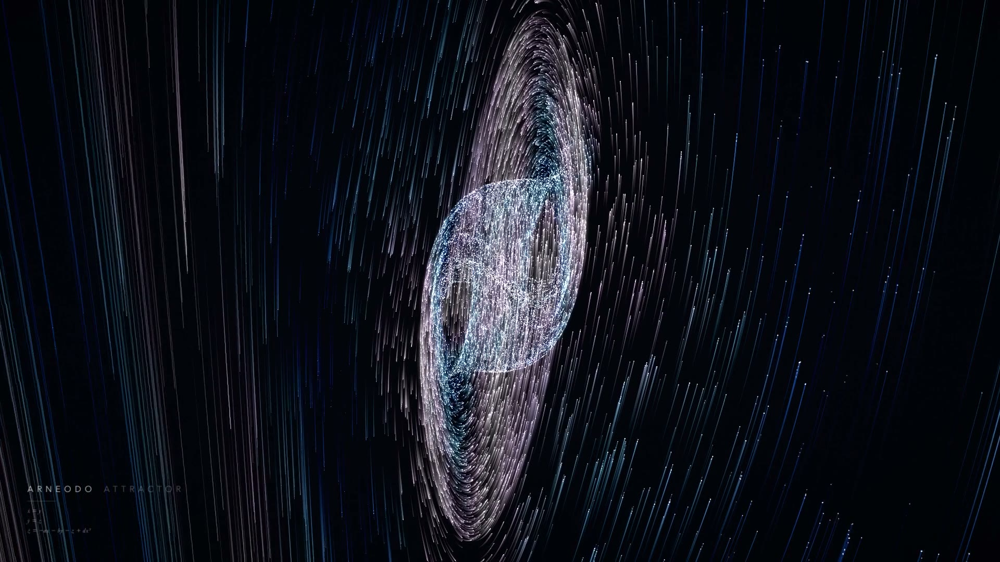
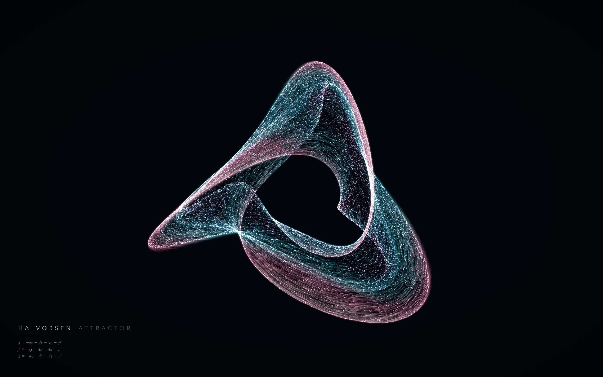
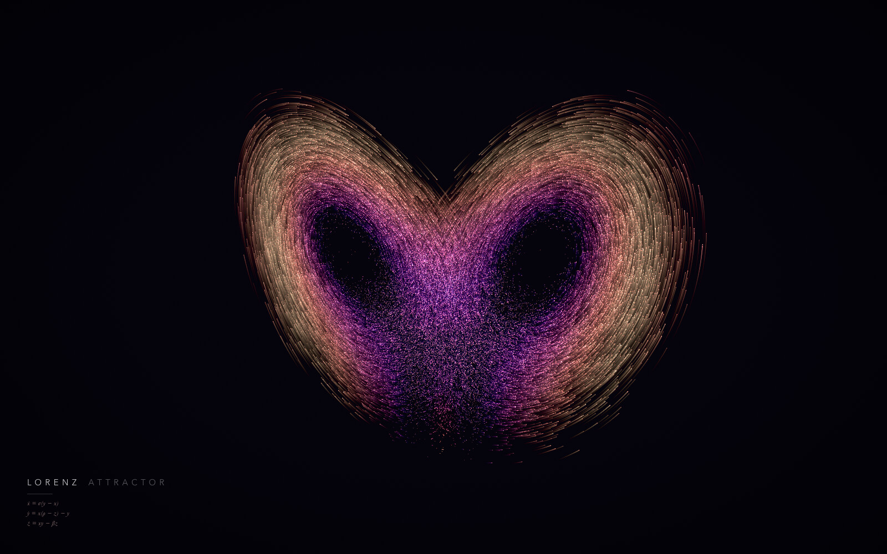
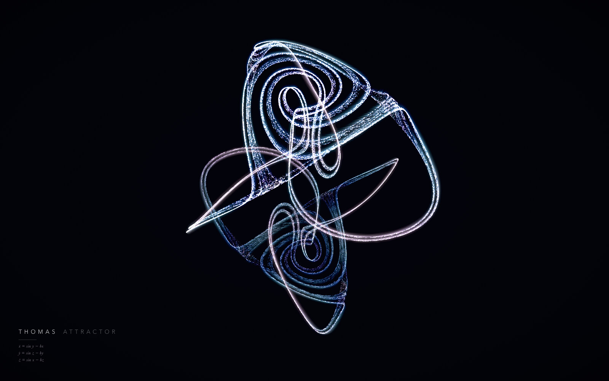
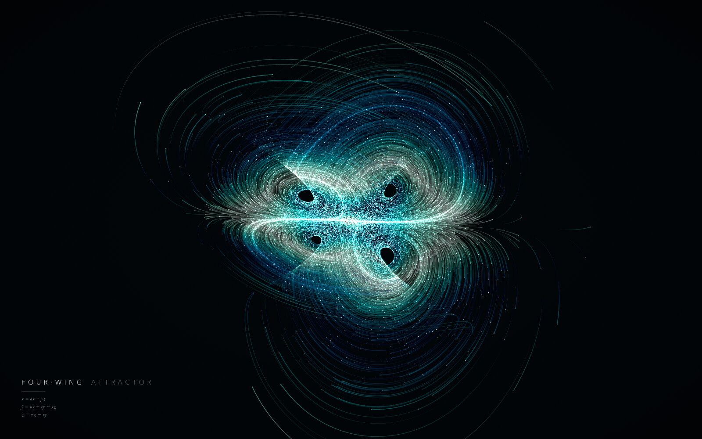

# Attractor

A macOS screensaver of strange attractors: tens of thousands of glowing particles tracing
chaotic flows, simulated and drawn entirely on the GPU with Metal.

<p align="center">
  <a href="docs/demo.mp4"></a>
  <br><sub><a href="docs/demo.mp4">▶ Watch the demo</a>: the Arneodo attractor condensing out of a cloud of particles (20 s)</sub>
</p>

<p>
  
  
  
  
</p>

Each time it starts, it picks a random attractor and palette, lets the shape condense out of a
random cloud of particles, and drifts the camera in a slow orbit. Every four minutes it fades to
the next one. The attractor's name and equations sit quietly in the corner.

**Attractors:** Lorenz, Aizawa, Halvorsen, Thomas, Chen, Dadras, Rössler, Four-Wing,
Burke–Shaw, Arneodo, Rucklidge.

## Install

Requires macOS 15 or later on Apple silicon, and the Xcode Command Line Tools
(`xcode-select --install`). Full Xcode is not needed.

```sh
git clone https://github.com/fellmirr/attractor-saver.git
cd attractor-saver
./build.sh install
```

Then pick **Attractor** in System Settings → Screen Saver.

To just watch it in a window, open `build/Attractor Viewer.app`:

| Key | Action |
| --- | --- |
| → / space, ← | next / previous attractor |
| p | next palette |
| r | random attractor and palette |
| s | restart (watch the shape form) |
| f | full screen |
| q / esc | quit |

## How it works

- **Simulation:** each particle is integrated with RK4 in a compute shader. The attractor's
  equations are spliced into the shader source, which is compiled at runtime, so every attractor
  gets a specialised kernel.
- **Normalisation:** a short hidden warm-up measures each attractor's centre, size and typical
  speed, so all of them are framed and paced consistently without hand-tuned constants.
- **Trails:** each frame, particles deposit anti-aliased line segments that follow their true
  curved path into an HDR buffer that fades over time. Particle heads are drawn as crisp sprites
  on top, followed by a subtle bloom, a soft tonemap and dithering.
- **Smoothness:** frames are driven by `CADisplayLink`, and new attractors are compiled and
  warmed up on a background queue, so switching never drops a frame. Typical cost is about
  2–2.5 ms of GPU time per frame on a 5K display (Apple M4).

## Debugging

Run the viewer from a terminal to see frame-pacing statistics:

```sh
"build/Attractor Viewer.app/Contents/MacOS/AttractorViewer" --stats [--screen 1 --fullscreen]
```

`ATTRACTOR_CYCLE=<seconds>` shortens the time per attractor, and `ATTRACTOR_DEBUG=1` logs slow
frames and brightness jumps.

## Tinkering

- `Sources/Shared/Attractors.swift`: equations, camera angles, palettes.
- `Sources/Shared/Renderer.swift`: particle look (`particleBrightness`, `headSize`,
  `lineWidth`, `flowSpeed`, `orbitSpeed`).
- `build/attractor-render`: offline tool for still renders, camera-angle contact sheets and
  GPU benchmarks:

  ```sh
  build/attractor-render --attractor thomas --palette opal --out thomas.png
  build/attractor-render --attractor arneodo --grow --skip 10 --seconds 20 --video demo.mp4
  build/attractor-render --attractor lorenz --sheet yaw --out angles.png
  build/attractor-render --attractor lorenz --size 2880x1800 --throughput
  ```

## License

MIT
